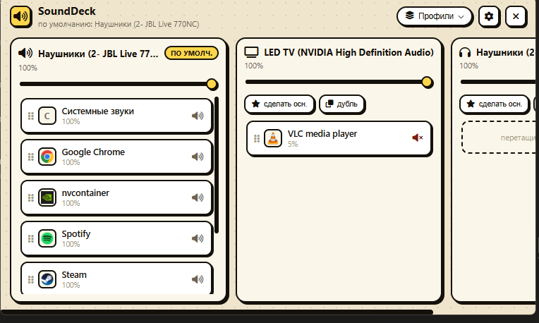
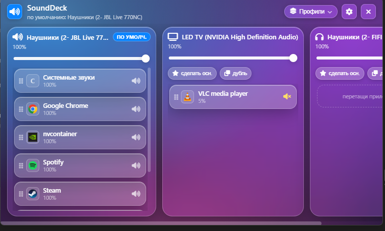
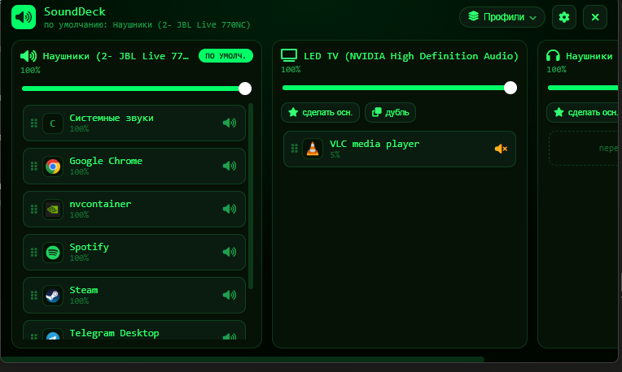

<div align="center">


# SoundDeck

**Leite den Ton jeder App auf jedes Gerät — wie ein Kanban-Board.**
Eine moderne Windows-Tray-App für App-weises Audio-Routing, Lautstärke, Ausgabe-Spiegelung und Layout-Profile.


[English](README.md) · [中文](README.zh.md) · [Español](README.es.md) · [Русский](README.ru.md) · **Deutsch** · [日本語](README.ja.md)



</div>

---

## Was es macht

SoundDeck lebt in der Taskleiste und verwandelt Windows-Audio in ein **Kanban-Board**: Spalten sind deine Ausgabegeräte, Karten sind die laufenden Apps. Zieh eine Karte auf ein Gerät, um den Ton dieser App dorthin zu senden — kein Wühlen mehr in den Windows-Sound-Einstellungen.

## Funktionen

- 🎛️ **Routing per Drag & Drop** — zieh die App-Karte auf ein beliebiges Ausgabegerät.
- 🔊 **Lautstärke / Stumm pro App und pro Gerät** — ein Klick auf eine Karte zeigt einen Regler mit ziehbarem Knopf.
- ⭐ **Standardgerät per Klick**.
- 🎧 **Gleichzeitige Ausgabe auf zwei Geräte** — spiegle die Hauptausgabe auf ein zweites Gerät (z. B. TV **und** Kopfhörer).
- 🩹 **Auto-Reparatur** — wenn ein Gerät aufwacht und Windows das Standardgerät verliert (das leidige leere Dropdown), stellt SoundDeck dein Layout automatisch wieder her.
- 💾 **Profile** — ganze Layouts speichern und über ein kompaktes Menü wechseln.
- 🚀 **Autostart bei Anmeldung** (optional).
- 🎨 **20 Designs** — über einen eigenen Design-Umschalter (siehe unten).
- 🌍 **Mehrsprachig** — folgt standardmäßig der Systemsprache; änderbar in den Einstellungen.
- 🧩 **Intelligente Gruppierung** — Mehrprozess-Apps (Spotify, Chrome, Discord) erscheinen als eine Karte und werden zusammen geroutet (in den Einstellungen abschaltbar).
- 🖱️ **Tray-Umschalter** — Klick zum Öffnen, erneuter Klick zum Ausblenden.

## Designs

20 fein abgestimmte Designs, umschaltbar über ein eigenes Dropdown:

<div align="center">

</div>

<table>
<tr>
<td><br/><b>Windows 11 (Fluent)</b></td>
<td><br/><b>iOS glass</b></td>
<td><br/><b>Dracula</b></td>
</tr>
<tr>
<td><br/><b>Synthwave</b></td>
<td><br/><b>Nord</b></td>
<td><br/><b>Matrix</b></td>
</tr>
</table>

Ebenfalls enthalten: Neubrutalism (Standard), Dark glass, Material, Paper, Solarized, Gruvbox, Monokai, Catppuccin, Rosé Pine, OLED, Forest, Ocean, Sunset, Cyberpunk.

## Installation

1. Lade **`SoundDeck.exe`** aus dem [neuesten Release](../../releases/latest). Es ist eine einzelne portable Datei (self-contained .NET 8) — keine Installation, kein .NET nötig.
2. Stelle sicher, dass die **Microsoft Edge WebView2 Runtime** vorhanden ist (auf aktuellen Windows 10/11 vorinstalliert).
3. Starte sie — SoundDeck läuft in der Taskleiste (Lautsprecher-Symbol). **Linksklick** auf das Symbol öffnet das Board.

> **SmartScreen-Hinweis.** Die Release-Exe ist **selbstsigniert**, nicht von einer vertrauenswürdigen CA — Windows SmartScreen kann daher warnen: **Weitere Informationen → Trotzdem ausführen**. Zum Prüfen/Vertrauen kannst du `SoundDeck-PublicCert.cer` (im Release enthalten) importieren. Ein vertrauenswürdiges kommerzielles Code-Signing-Zertifikat würde die Warnung vollständig entfernen.

## Wie es funktioniert

- **Hülle:** C# / .NET 8 **WPF**-Host mit Tray-Symbol und rahmenlosem Flyout-Fenster.
- **Oberfläche:** gerendert in **WebView2** — reines HTML/CSS/JS (kein Framework), kommuniziert per `postMessage` mit C#.
- **Audio:** [NAudio](https://github.com/naudio/NAudio) für Core Audio; Standardgerät und App-Routing nutzen die **undokumentierten** COM-Schnittstellen `IPolicyConfig` / `IAudioPolicyConfig` (gleicher Ansatz wie [EarTrumpet](https://github.com/File-New-Project/EarTrumpet)). Läuft auf Windows 10 1803+ und Windows 11.
- **Spiegelung:** WASAPI-Loopback-Aufnahme des Hauptgeräts → `WasapiOut` auf dem zweiten Gerät (auf dessen Format resampelt).

## Aus dem Quellcode bauen

```bash
cd app
dotnet run                       # Entwicklungs-Build
```

Portable Single-File-Release:

```bash
dotnet publish -c Release -r win-x64 --self-contained true ^
  -p:PublishSingleFile=true -p:EnableCompressionInSingleFile=false ^
  -p:IncludeNativeLibrariesForSelfExtract=true -o publish
```

## Installer (optional)

Ein [Inno-Setup](https://jrsoftware.org/isinfo.php)-Skript liegt unter [`installer/SoundDeck.iss`](installer/SoundDeck.iss). Baue es mit Inno Setup 6 (`ISCC.exe`) zu einer `setup.exe` mit Startmenü-Verknüpfung und Deinstaller.

## Einschränkungen

- **Spiegelung ist geräteweit** — ein zweites Gerät spiegelt die Hauptausgabe. Echte App-weise Spiegelung erfordert Prozess-Loopback (geplant).
- Das Routing nutzt **undokumentierte** Windows-COM-Schnittstellen; das Verhalten kann zwischen Windows-Builds variieren.

## Danksagung

- Icons: [Font Awesome Free](https://fontawesome.com) (CC BY 4.0).
- Ansatz inspiriert von [EarTrumpet](https://github.com/File-New-Project/EarTrumpet).

## Lizenz

[MIT](LICENSE) © 2026 vladbogun1
