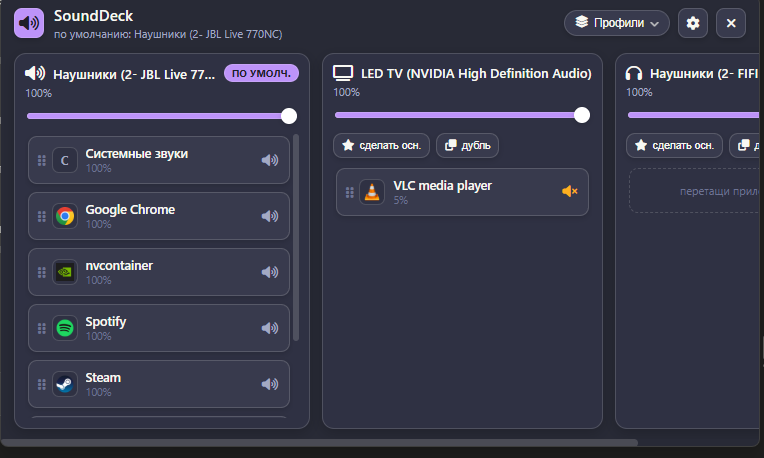

<div align="center">


# SoundDeck

**Envía el sonido de cualquier app a cualquier dispositivo — como un tablero kanban.**
Una app de bandeja para Windows para enrutar audio por aplicación, controlar volumen, duplicar salidas y guardar perfiles de disposición.


[English](README.md) · [中文](README.zh.md) · **Español** · [Русский](README.ru.md) · [Deutsch](README.de.md) · [日本語](README.ja.md)


</div>

---

## Qué hace

SoundDeck vive en la bandeja del sistema y convierte el audio de Windows en un **tablero kanban**: las columnas son tus dispositivos de salida y las tarjetas son las apps en ejecución. Arrastra una tarjeta a un dispositivo para enviar allí el sonido de esa app — sin rebuscar en la configuración de sonido de Windows.

## Características

- 🎛️ **Enrutado por arrastrar y soltar** — mueve el sonido de una app a cualquier dispositivo arrastrando su tarjeta.
- 🔊 **Volumen / silencio por app y por dispositivo** — pulsa una tarjeta para ver un deslizador con perilla arrastrable.
- ⭐ **Dispositivo predeterminado con un clic**.
- 🎧 **Salida a dos dispositivos a la vez** — duplica la salida principal en un segundo dispositivo (p. ej. la TV **y** los auriculares).
- 🩹 **Auto-reparación** — cuando un dispositivo despierta y Windows pierde el predeterminado (el molesto menú vacío), SoundDeck vuelve a aplicar tu disposición automáticamente.
- 💾 **Perfiles** — guarda disposiciones completas y cámbialas desde un menú compacto.
- 🚀 **Inicio con el sistema** (opcional).
- 🎨 **20 temas** — desde un selector de temas personalizado (ver abajo).
- 🌍 **Multi-idioma** — por defecto sigue el idioma del sistema; se cambia en Ajustes.
- 🧩 **Agrupación inteligente** — las apps multiproceso (Spotify, Chrome, Discord) aparecen como una sola tarjeta y se enrutan juntas (se puede desactivar en Ajustes).
- 🖱️ **Alternar desde la bandeja** — clic para abrir, otro clic para ocultar.
- 🔄 **Se instala y se actualiza sola** — ejecuta el exe una vez desde cualquier sitio; se mueve a `%LocalAppData%\Programs\SoundDeck` y después se actualiza en su sitio desde las releases de GitHub.
- 🙈 **Oculta dispositivos** que nunca tocas (cables virtuales, monitores) en Ajustes → Dispositivos.
- 📐 **Se adapta a tus dispositivos** — la ventana crece para mostrar todos los dispositivos lado a lado (en filas en pantallas pequeñas); arrastra una tarjeta a cualquier sitio, con una barra de destino para las columnas fuera de la vista.

## Temas

20 temas cuidados, conmutables desde un menú desplegable personalizado:

<div align="center">

</div>

<table>
<tr>
<td><br/><b>Windows 11 (Fluent)</b></td>
<td><br/><b>iOS glass</b></td>
<td><br/><b>Dracula</b></td>
</tr>
<tr>
<td><br/><b>Synthwave</b></td>
<td><br/><b>Nord</b></td>
<td><br/><b>Matrix</b></td>
</tr>
</table>

También incluye: Neubrutalism (por defecto), Dark glass, Material, Paper, Solarized, Gruvbox, Monokai, Catppuccin, Rosé Pine, OLED, Forest, Ocean, Sunset, Cyberpunk.

## Instalación

1. Descarga **`SoundDeck.exe`** de la [última release](../../releases/latest) (.NET 8 autocontenido — no necesitas .NET).
2. Asegúrate de tener el **Microsoft Edge WebView2 Runtime** (preinstalado en Windows 10/11 actuales).
3. Ejecútalo una vez desde donde esté. SoundDeck **se instala solo** en `%LocalAppData%\Programs\SoundDeck` (sin permisos de administrador), crea un acceso directo en el menú Inicio y una entrada en *Aplicaciones y características* (desinstala desde ahí), mueve el inicio automático a la nueva ruta y se reinicia desde allí. Después puedes borrar el archivo descargado.
4. **Las actualizaciones son automáticas:** cada 6 horas revisa las releases de GitHub, descarga el nuevo exe, lo verifica (tamaño, SHA-256, mismo certificado de firma) y lo sustituye mientras la ventana está cerrada. Desactívalo o actualiza a mano en Ajustes → Actualizaciones.

¿Prefieres una copia portable? Arráncalo con `--portable` o pon un archivo vacío llamado `portable` junto al exe.
**Clic izquierdo** en el icono de la bandeja (altavoz) abre el tablero.

> **Nota sobre SmartScreen.** El exe está **autofirmado**, no firmado por una CA de confianza, así que Windows SmartScreen puede avisar — pulsa **Más información → Ejecutar de todas formas**. Puedes inspeccionar/confiar en el editor importando `SoundDeck-PublicCert.cer` (incluido en la versión). Un certificado comercial de confianza eliminaría el aviso por completo.

## Cómo funciona

- **Contenedor:** host **WPF** en C# / .NET 8 con icono de bandeja y ventana emergente sin bordes.
- **Interfaz:** renderizada en **WebView2** — HTML/CSS/JS puro (sin framework), comunicándose con C# vía `postMessage`.
- **Audio:** [NAudio](https://github.com/naudio/NAudio) para Core Audio; el dispositivo predeterminado y el enrutado por app usan las interfaces COM **no documentadas** `IPolicyConfig` / `IAudioPolicyConfig` (el mismo enfoque que [EarTrumpet](https://github.com/File-New-Project/EarTrumpet)). Funciona en Windows 10 1803+ y Windows 11.
- **Duplicado:** captura loopback WASAPI del dispositivo principal → `WasapiOut` en el segundo dispositivo (con remuestreo a su formato).

## Compilar desde el código

```bash
cd app
dotnet run                       # build de desarrollo
```

Versión portátil de un solo archivo:

```bash
dotnet publish -c Release -r win-x64 --self-contained true ^
  -p:PublishSingleFile=true -p:EnableCompressionInSingleFile=false ^
  -p:IncludeNativeLibrariesForSelfExtract=true -o publish
```

## Limitaciones

- **El duplicado es a nivel de dispositivo** — un segundo dispositivo refleja la salida principal. El duplicado real por app requiere captura loopback por proceso (planeado).
- El enrutado usa interfaces COM **no documentadas** de Windows; el comportamiento puede variar entre versiones.

## Créditos

- Iconos: [Font Awesome Free](https://fontawesome.com) (CC BY 4.0).
- Enfoque inspirado en [EarTrumpet](https://github.com/File-New-Project/EarTrumpet).

## Licencia

[MIT](LICENSE) © 2026 vladbogun1
