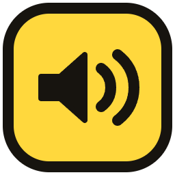
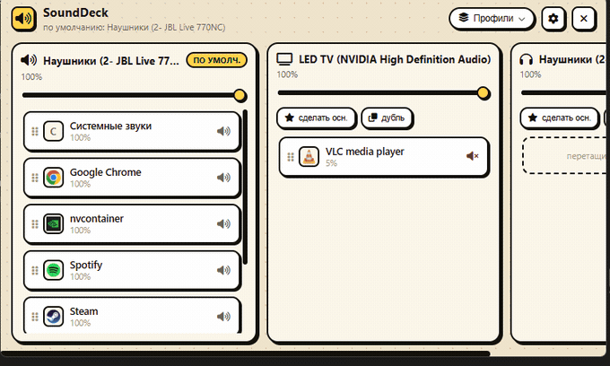
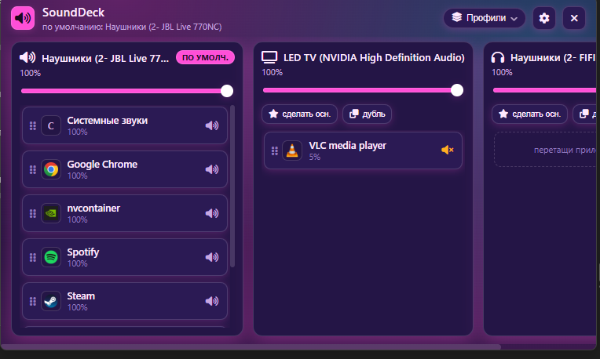

<div align="center">



# SoundDeck

**Route any app's sound to any device — like a kanban board.**
A modern Windows tray app for per-app audio routing, volume, mirroring and layout profiles.


**English** · [中文](README.zh.md) · [Español](README.es.md) · [Русский](README.ru.md) · [Deutsch](README.de.md) · [日本語](README.ja.md)


</div>

---

## What it does

SoundDeck lives in your system tray and turns Windows audio into a **kanban board**:
columns are your output devices, cards are the running apps. Drag a card onto a
device to send that app there. No more digging through Windows sound settings.

## Features

- 🎛️ **Drag & drop routing** — move an app's sound to any output device by dragging its card.
- 🔊 **Per-app & per-device volume / mute** — click a card to reveal a slider with a draggable knob.
- ⭐ **One-click default device** — make any device the system default instantly.
- 🎧 **Mirror to two outputs at once** — play the main sound on a second device simultaneously (e.g. TV **and** headphones).
- 🩹 **Auto-heal** — when a device wakes from sleep and Windows drops the default (the dreaded empty dropdown), SoundDeck re-applies your layout automatically.
- 💾 **Profiles** — save whole layouts and switch between them from a compact dropdown.
- 🚀 **Launch on login** — optional autostart.
- 🎨 **20 themes** — from a custom theme picker (see below).
- 🧩 **Smart grouping** — multi-process apps (Spotify, Chrome, Discord) show as a single card and route together.
- 🖱️ **Tray toggle** — click the tray icon to open, click again to hide.

## Themes

20 hand-tuned themes, switchable from a custom dropdown — pick your vibe:

<div align="center">

</div>

<table>
<tr>
<td><br/><b>Windows 11 (Fluent)</b></td>
<td><br/><b>iOS glass</b></td>
<td><br/><b>Dracula</b></td>
</tr>
<tr>
<td><br/><b>Synthwave</b></td>
<td><br/><b>Nord</b></td>
<td><br/><b>Matrix</b></td>
</tr>
</table>

Also included: Neubrutalism (default), Dark glass, Material, Paper, Solarized,
Gruvbox, Monokai, Catppuccin, Rosé Pine, OLED, Forest, Ocean, Sunset, Cyberpunk.

## Install

1. Download **`SoundDeck.exe`** from the [latest release](../../releases/latest).
   It's a single portable file (self-contained .NET 8) — no installation, no .NET required.
2. Make sure the **Microsoft Edge WebView2 Runtime** is present (preinstalled on current Windows 10/11).
3. Run it — SoundDeck starts in the tray (speaker icon). **Left-click** the icon to open the board.

> **SmartScreen note.** The release exe is **self-signed**, not signed by a trusted CA,
> so Windows SmartScreen may show a warning — click **More info → Run anyway**.
> To inspect/trust the publisher you can import `SoundDeck-PublicCert.cer` (included in the release).
> A trusted commercial code-signing certificate would remove the warning entirely.

## How it works

- **Shell:** C# / .NET 8 **WPF** host with a tray icon and a borderless flyout window.
- **UI:** rendered in **WebView2** — plain HTML/CSS/JS (no framework), talking to C# over `postMessage`.
- **Audio:** [NAudio](https://github.com/naudio/NAudio) for Core Audio; the default device and per-app
  routing use the **undocumented** `IPolicyConfig` / `IAudioPolicyConfig` COM interfaces
  (the same approach as [EarTrumpet](https://github.com/File-New-Project/EarTrumpet)). Works on Windows 10 1803+ and Windows 11.
- **Mirror:** WASAPI loopback capture of the primary device → `WasapiOut` on the second device (resampled to its mix format).

## Build from source

```bash
cd app
dotnet run                       # dev build (loose web assets)
```

Portable single-file release:

```bash
dotnet publish -c Release -r win-x64 --self-contained true ^
  -p:PublishSingleFile=true -p:EnableCompressionInSingleFile=false ^
  -p:IncludeNativeLibrariesForSelfExtract=true -o publish
```

## Installer (optional)

An [Inno Setup](https://jrsoftware.org/isinfo.php) script is provided at
[`installer/SoundDeck.iss`](installer/SoundDeck.iss). Build it with Inno Setup 6
(`ISCC.exe`) to produce a `setup.exe` with a Start-menu shortcut and uninstaller.

## Limitations

- **Mirror is device-level** — a second device mirrors the primary output. True per-app
  mirror needs process-loopback capture (planned).
- Routing relies on **undocumented** Windows COM interfaces; behaviour can vary across Windows builds.

## Credits

- Icons: [Font Awesome Free](https://fontawesome.com) (CC BY 4.0).
- Approach inspired by [EarTrumpet](https://github.com/File-New-Project/EarTrumpet).

## License

[MIT](LICENSE) © 2026 vladbogun1
