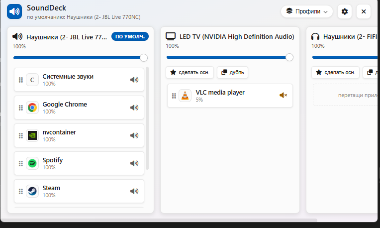

<div align="center">


# SoundDeck

**Направляй звук любого приложения на любое устройство — как на канбан-доске.**
Современное приложение в системном трее для Windows: маршрутизация звука по приложениям, громкость, дубль вывода и профили раскладок.


[English](README.md) · [中文](README.zh.md) · [Español](README.es.md) · **Русский** · [Deutsch](README.de.md) · [日本語](README.ja.md)


</div>

---

## Что это

SoundDeck живёт в системном трее и превращает звук Windows в **канбан-доску**: колонки — это устройства вывода, карточки — запущенные приложения. Перетащи карточку на устройство — и звук приложения пойдёт туда. Больше не нужно копаться в настройках звука Windows.

## Возможности

- 🎛️ **Маршрутизация drag & drop** — перетаскиванием карточки отправляй звук приложения на любой выход.
- 🔊 **Громкость / mute по приложению и по устройству** — клик по карточке раскрывает ползунок с перетаскиваемой точкой.
- ⭐ **Устройство по умолчанию в один клик**.
- 🎧 **Вывод сразу на два устройства** — дублируй основной звук на второе устройство (например, телевизор **и** наушники).
- 🩹 **Авто-лечилка** — когда устройство просыпается и Windows теряет дефолт (тот самый баг с пустым списком), SoundDeck сам заново применяет раскладку.
- 💾 **Профили** — сохраняй целые раскладки и переключай их из компактного меню.
- 🚀 **Автозапуск при входе** (опционально).
- 🎨 **20 тем** — через кастомный выбор темы (см. ниже).
- 🌍 **Мультиязычность** — по умолчанию язык системы, меняется в настройках.
- 🧩 **Умная группировка** — многопроцессные приложения (Spotify, Chrome, Discord) показываются одной карточкой и маршрутизируются вместе (можно отключить в настройках).
- 🖱️ **Тоггл из трея** — клик открывает, повторный клик сворачивает.

## Темы

20 продуманных тем, переключаются кастомным выпадающим списком:

<div align="center">

</div>

<table>
<tr>
<td><br/><b>Windows 11 (Fluent)</b></td>
<td><br/><b>iOS glass</b></td>
<td><br/><b>Dracula</b></td>
</tr>
<tr>
<td><br/><b>Synthwave</b></td>
<td><br/><b>Nord</b></td>
<td><br/><b>Matrix</b></td>
</tr>
</table>

Также в комплекте: Neubrutalism (по умолчанию), Dark glass, Material, Paper, Solarized, Gruvbox, Monokai, Catppuccin, Rosé Pine, OLED, Forest, Ocean, Sunset, Cyberpunk.

## Установка

1. Скачай **`SoundDeck.exe`** из [последнего релиза](../../releases/latest). Это один переносимый файл (self-contained .NET 8) — без установки и без предустановленного .NET.
2. Убедись, что установлен **Microsoft Edge WebView2 Runtime** (обычно уже есть в Windows 10/11).
3. Запусти — SoundDeck стартует в трее (иконка динамика). **Клик левой кнопкой** по иконке открывает доску.

> **Про SmartScreen.** Релизный exe **самоподписан**, а не подписан доверенным центром сертификации, поэтому Windows SmartScreen может предупредить — нажми **Подробнее → Выполнить в любом случае**. Проверить/доверить издателю можно, импортировав `SoundDeck-PublicCert.cer` (есть в релизе). Доверенный коммерческий сертификат для подписи кода убрал бы предупреждение полностью.

## Как устроено

- **Оболочка:** хост на C# / .NET 8 **WPF** с иконкой в трее и безрамочным окном-флаутом.
- **Интерфейс:** рендерится в **WebView2** — чистый HTML/CSS/JS (без фреймворка), общается с C# через `postMessage`.
- **Звук:** [NAudio](https://github.com/naudio/NAudio) для Core Audio; смена устройства по умолчанию и маршрутизация по приложениям — через **недокументированные** COM-интерфейсы `IPolicyConfig` / `IAudioPolicyConfig` (тот же подход, что у [EarTrumpet](https://github.com/File-New-Project/EarTrumpet)). Работает на Windows 10 1803+ и Windows 11.
- **Дубль:** WASAPI loopback-захват основного устройства → `WasapiOut` на втором устройстве (с ресемплингом под его формат).

## Сборка из исходников

```bash
cd app
dotnet run                       # dev-сборка (свободные web-ассеты)
```

Переносимый single-file релиз:

```bash
dotnet publish -c Release -r win-x64 --self-contained true ^
  -p:PublishSingleFile=true -p:EnableCompressionInSingleFile=false ^
  -p:IncludeNativeLibrariesForSelfExtract=true -o publish
```

## Установщик (опционально)

В [`installer/SoundDeck.iss`](installer/SoundDeck.iss) лежит скрипт [Inno Setup](https://jrsoftware.org/isinfo.php). Собери его в Inno Setup 6 (`ISCC.exe`), чтобы получить `setup.exe` с ярлыком в меню «Пуск» и деинсталлятором.

## Ограничения

- **Дубль на уровне устройства** — второе устройство зеркалит основной вывод. Точечный дубль отдельного приложения требует process-loopback (в планах).
- Маршрутизация использует **недокументированные** COM-интерфейсы Windows; поведение может отличаться между сборками ОС.

## Благодарности

- Иконки: [Font Awesome Free](https://fontawesome.com) (CC BY 4.0).
- Подход вдохновлён [EarTrumpet](https://github.com/File-New-Project/EarTrumpet).

## Лицензия

[MIT](LICENSE) © 2026 vladbogun1
