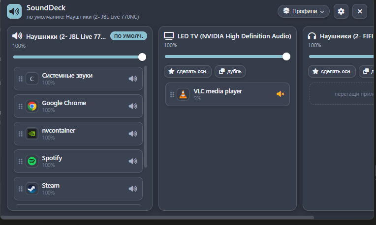

<div align="center">


# SoundDeck

**把任意应用的声音路由到任意设备 —— 像看板一样。**
一款现代的 Windows 托盘应用，用于按应用路由音频、调节音量、镜像输出和保存布局配置。


[English](README.md) · **中文** · [Español](README.es.md) · [Русский](README.ru.md) · [Deutsch](README.de.md) · [日本語](README.ja.md)


</div>

---

## 功能简介

SoundDeck 常驻系统托盘，把 Windows 音频变成一块**看板**：列是输出设备，卡片是正在运行的应用。把卡片拖到某个设备上，就把该应用的声音送到那里 —— 不用再翻 Windows 声音设置。

## 特性

- 🎛️ **拖放路由** —— 拖动应用卡片即可把它的声音切到任意输出设备。
- 🔊 **按应用 / 按设备调音量、静音** —— 点击卡片会展开带可拖动圆点的滑块。
- ⭐ **一键设为默认设备**。
- 🎧 **同时输出到两个设备** —— 把主输出镜像到第二个设备（例如电视**和**耳机同时响）。
- 🩹 **自动修复** —— 当设备从睡眠唤醒、Windows 丢失默认设备（那个空下拉框的老毛病）时，自动重新应用你的布局。
- 💾 **配置** —— 保存整套布局并从紧凑的下拉框切换。
- 🚀 **开机启动**（可选）。
- 🎨 **20 种主题** —— 通过自定义主题选择器切换（见下）。
- 🌍 **多语言** —— 默认跟随系统语言，可在设置中切换。
- 🧩 **智能合并** —— 多进程应用（Spotify、Chrome、Discord）显示为一张卡片并一起路由（可在设置中关闭）。
- 🖱️ **托盘开关** —— 点击托盘图标打开，再点一次收起。
- 🔄 **自动安装与自动更新** — 在任意位置运行一次 exe，它会搬到 `%LocalAppData%\Programs\SoundDeck`，之后直接从 GitHub Releases 原地更新。
- 🙈 **隐藏从不使用的设备**（虚拟声卡、显示器等）— 设置 → 设备。
- 📐 **窗口自适应设备数量** — 所有设备并排显示（小屏幕上自动换行）；卡片可拖到任意位置，看不到的列会在底部出现投放栏。

## 主题

20 种精心调校的主题，通过自定义下拉框切换：

<div align="center">

</div>

<table>
<tr>
<td><br/><b>Windows 11 (Fluent)</b></td>
<td><br/><b>iOS glass</b></td>
<td><br/><b>Dracula</b></td>
</tr>
<tr>
<td><br/><b>Synthwave</b></td>
<td><br/><b>Nord</b></td>
<td><br/><b>Matrix</b></td>
</tr>
</table>

还包含：Neubrutalism（默认）、Dark glass、Material、Paper、Solarized、Gruvbox、Monokai、Catppuccin、Rosé Pine、OLED、Forest、Ocean、Sunset、Cyberpunk。

## 安装

1. 从[最新 Release](../../releases/latest) 下载 **`SoundDeck.exe`**（自包含 .NET 8，无需安装 .NET）。
2. 确认已安装 **Microsoft Edge WebView2 Runtime**（新版 Windows 10/11 已预装）。
3. 在下载位置运行一次即可。SoundDeck 会**自动安装**到 `%LocalAppData%\Programs\SoundDeck`（无需管理员权限），创建开始菜单快捷方式和「应用和功能」条目（可在那里卸载），把开机自启动改到新路径，并从那里重新启动。之后可以删除下载的文件。
4. **自动更新：** 每 6 小时检查一次 GitHub Releases，下载新 exe 并校验（大小、SHA-256、相同的签名证书），在窗口关闭时完成替换。可在 设置 → 更新 中关闭或手动更新。

想要便携版？使用 `--portable` 启动，或在 exe 旁放一个名为 `portable` 的空文件。
**左键单击**托盘图标（扬声器）即可打开面板。

> **SmartScreen 提示**：发布的 exe 为**自签名**，并非由受信任的 CA 签名，因此 Windows SmartScreen 可能会提示 —— 点击**更多信息 → 仍要运行**。可导入随发布提供的 `SoundDeck-PublicCert.cer` 查看/信任发布者。使用受信任的商业代码签名证书可彻底消除该提示。

## 工作原理

- **外壳：** C# / .NET 8 **WPF**，带托盘图标和无边框弹出窗口。
- **界面：** 由 **WebView2** 渲染 —— 纯 HTML/CSS/JS（无框架），通过 `postMessage` 与 C# 通信。
- **音频：** 使用 [NAudio](https://github.com/naudio/NAudio) 访问 Core Audio；默认设备与按应用路由使用**未公开的** `IPolicyConfig` / `IAudioPolicyConfig` COM 接口（与 [EarTrumpet](https://github.com/File-New-Project/EarTrumpet) 相同的做法）。支持 Windows 10 1803+ 与 Windows 11。
- **镜像：** 对主设备做 WASAPI 环回捕获 → 用 `WasapiOut` 在第二设备播放（重采样到其混音格式）。

## 从源码构建

```bash
cd app
dotnet run                       # 开发构建（松散的 web 资源）
```

便携单文件发布：

```bash
dotnet publish -c Release -r win-x64 --self-contained true ^
  -p:PublishSingleFile=true -p:EnableCompressionInSingleFile=false ^
  -p:IncludeNativeLibrariesForSelfExtract=true -o publish
```

## 已知限制

- **镜像是设备级的** —— 第二设备镜像主输出。真正的按应用镜像需要进程环回捕获（计划中）。
- 路由依赖**未公开的** Windows COM 接口；在不同 Windows 版本上行为可能不同。

## 致谢

- 图标：[Font Awesome Free](https://fontawesome.com)（CC BY 4.0）。
- 思路参考 [EarTrumpet](https://github.com/File-New-Project/EarTrumpet)。

## 许可证

[MIT](LICENSE) © 2026 vladbogun1
